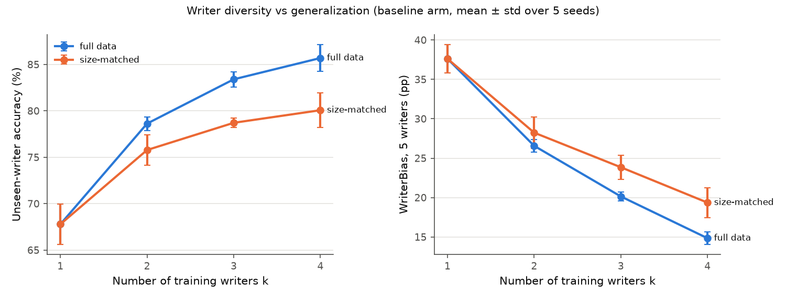
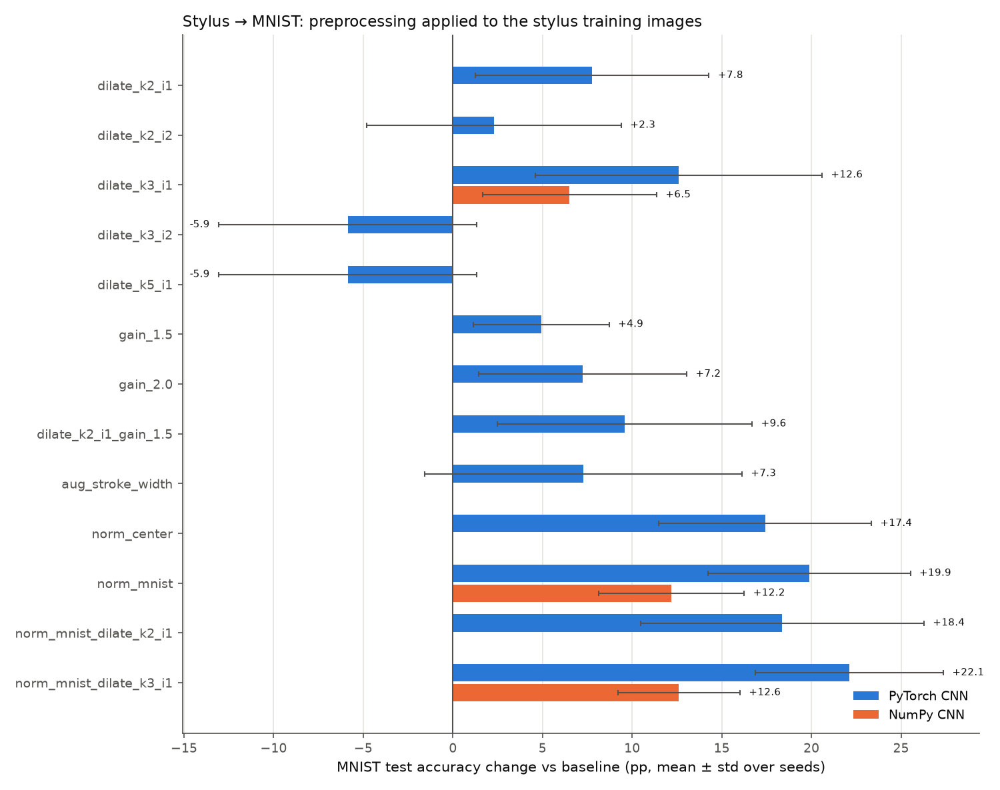
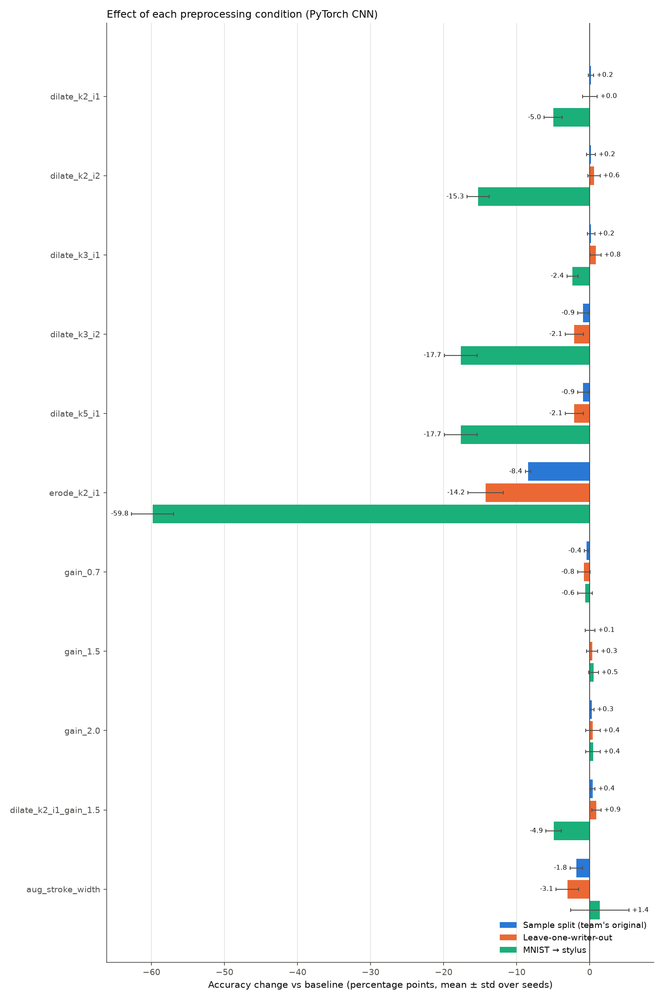
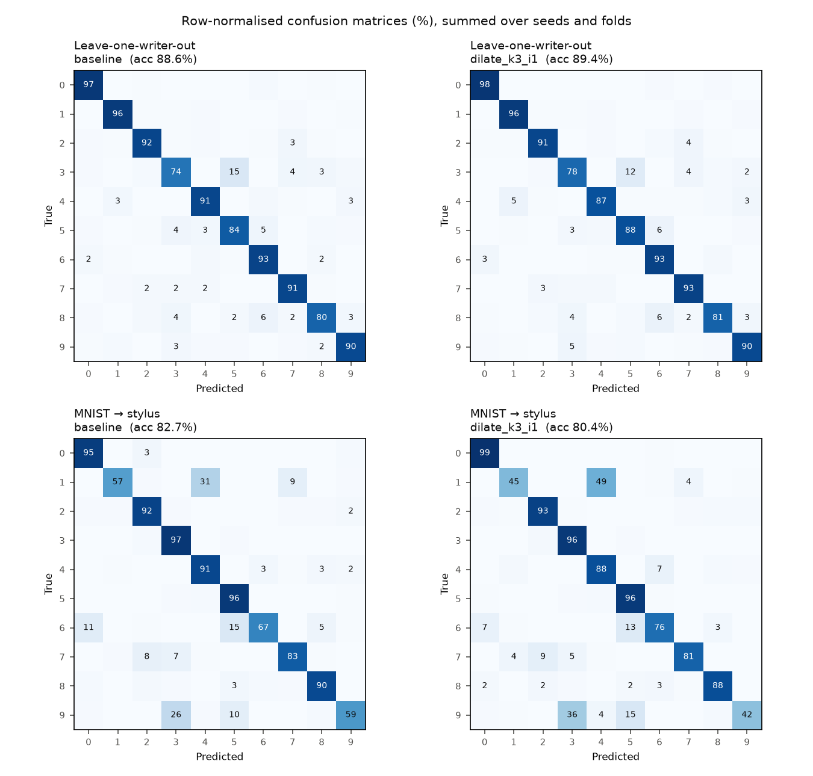
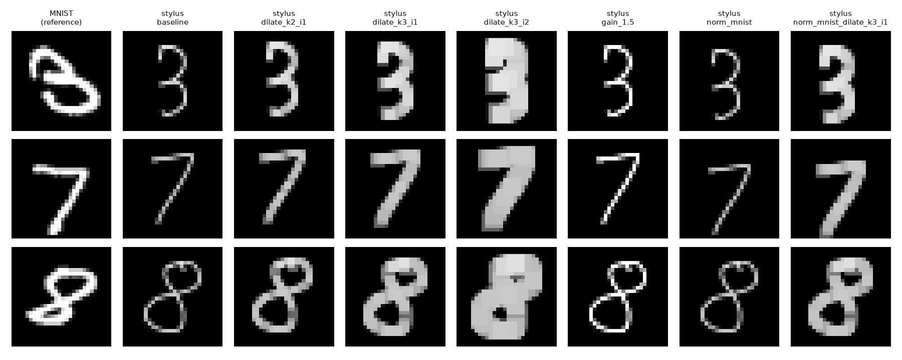

# Handwritten digits: CNNs on a team-collected stylus dataset

This repo studies how well a CNN trained on stylus-written digits generalizes to new writers and to MNIST. It does so with controlled, multi-seed experiments on a 10,000-digit dataset that the team collected from 5 writers. **The full write-up is [`REPORT.md`](REPORT.md)**, organized by research question.

It extends the team project [`ProfK602170/CustomDataCNN`](https://github.com/ProfK602170/CustomDataCNN) (full commit history kept). It reuses the config-driven CNN and run-tracking structure from [`JimmyK300/autoresearch-cnn-rocm`](https://github.com/JimmyK300/autoresearch-cnn-rocm).

## Headline findings

All numbers are PyTorch CNN accuracy, mean ± std over 5 seeds, on held-out data.

1. **Writer diversity drives cross-writer generalization** (regimes R1–R5, 1,825 runs). Going from 1 to 4 training writers raises unseen-writer accuracy from 67.8 ± 2.2% to 85.7 ± 1.4%, and lowers WriterBias (max − min accuracy across writers) from 37.6 to 14.8 pp. With the total training size fixed at one writer's worth, 4 writers still beat 1 by +12.3 ± 2.0 pp (p < 0.001).
2. **MNIST pre-training plus fine-tuning is best.** It reaches 94.4 ± 0.4% on unseen writers and loses only 0.3 pp on MNIST at lr × 0.1 for 5 epochs. Harder fine-tuning (lr × 1 or 15 epochs) forgets 5–9 pp of MNIST and does not help the writers.
3. **MNIST's edge on the writers is size, not diversity.** At one writer's size (1,712 images), an MNIST-trained model gets only 44.6% on the writers, 23.2 pp below a single stylus writer. It needs all 60,000 images to reach 82.9%. (Added after the main results.) On a composite test of both domains, though, MNIST is the better base at equal size (balanced accuracy 67.0% vs 53.8% for one writer, 81.5% vs 69.6% for 4 writers), because stylus-trained models collapse on MNIST.
4. **The MNIST ↔ stylus gap is mostly geometry and stroke width.** Centre-of-mass position (+16.6 pp) and stroke width (+12.7 pp) matter; intensity and slant do not. A model trained on thin, box-centred stylus digits reads MNIST's thick strokes as 8 (33% of predictions) and almost never gets 7 right; its uniform 5-writer training data explains why the gap is so one-sided (at equal size both directions score about 43–45%). Normalizing both domains, as MNIST was built, plus dilation and light affine jitter takes stylus → MNIST from 48.1% to **82.8 ± 2.1%** (confirmatory, p = 2e-4). MNIST → stylus goes from 80.9% to **91.1 ± 2.7%** (p = 0.001).
5. **With equal training effort, less data means a larger generalization gap** (1.6 → 7.0 pp at 10% of the data, p < 1e-4); the flat gap in the fixed-epoch sweep was underfitting.
6. **Within stylus data, dilation barely matters** (under 1 pp for unseen writers, as below).

Multiple comparisons: 6 tests were pre-registered and are confirmatory; the other 185 are Holm-corrected together in [`results/HOLM.md`](results/HOLM.md) (50 survive).



## Dilation study

The table shows PyTorch CNN accuracy, mean ± std over 5 seeds. Δ is the paired change against the baseline in **percentage points (pp)**. The 3×3 dilation (`dilate_k3_i1`) was chosen as the headline condition before any run.

| Protocol | Baseline | 3×3 dilation, 1 pass | Δ (pp) | Relative | p (paired t, 5 seeds) |
|---|---|---|---|---|---|
| Sample split (team's original) | 96.13 ± 0.52 | 96.31 ± 0.26 | +0.18 ± 0.52 | +0.2% | 0.47 |
| **Leave-one-writer-out** | 88.63 ± 1.36 | 89.44 ± 1.37 | **+0.81 ± 0.75** | +0.9% | 0.07 |
| MNIST → stylus (dilate test images only) | 82.72 ± 2.13 | 80.36 ± 1.90 | −2.36 ± 0.76 | −2.9% | 0.002 |

The from-scratch NumPy CNN shows the same pattern. Leave-one-writer-out: 87.50 ± 1.02 → 88.81 ± 1.24 (+1.31 ± 1.14 pp, p = 0.06). MNIST → stylus: 70.04 ± 4.20 → 73.47 ± 2.56 (+3.43 ± 3.36 pp, 5/5 seeds improved, p = 0.09).

What this shows:

1. **New writers are the real gap.** The same model loses **7.5 pp** (96.1% → 88.6%) when the test writer is held out of training. The team's original split mixed every writer's samples into both train and test, which hid this.
2. **Light dilation helps a little, at most.** One 3×3 pass gains under 1 pp for the PyTorch CNN on unseen writers, and 1.3 pp for the NumPy CNN. Four of five seeds improve, but neither result is significant at p < 0.05.
3. **Heavy dilation hurts.** Two 3×3 passes (equal to one 5×5 pass) lose 2.1 pp on unseen writers and 17.7 pp (−21% relative) in the MNIST → stylus test. Erosion is far worse: thin strokes vanish.
4. **The large dilation effect is in the other direction.** An earlier informal note recalled a ~20% gain from dilation. None of the three protocols above shows it. It appears only when training on stylus digits and testing on MNIST: +12.6 pp absolute (+29.6% relative) from dilation alone, and +22.1 pp with normalization (see below).

### Stylus → MNIST (the team's Regime 4)

Train on all 10,000 stylus digits, test on the 10,000 MNIST test images, and preprocess the training images only.

| Condition (5 seeds) | PyTorch | NumPy |
|---|---|---|
| Baseline | 47.35 ± 7.98 | 50.85 ± 5.81 |
| 3×3 dilation, 1 pass (pre-registered) | 59.94 ± 3.02 (+12.59 pp, p = 0.024) | 57.37 ± 2.92 (+6.52 pp, p = 0.040) |
| MNIST normalization (size + centre) | 67.22 ± 2.96 (+19.87 pp, p = 0.001) | 63.05 ± 2.80 (+12.20 pp) |
| Normalization + 3×3 dilation | 69.46 ± 3.19 (+22.11 pp, p = 0.001) | 63.46 ± 3.59 (+12.61 pp) |



Full tables for all conditions, both models and every protocol are in [`results/RESULTS.md`](results/RESULTS.md). Raw per-run records, including confusion matrices, are in [`results/runs.jsonl`](results/runs.jsonl).





## Dataset

The team collected **10,000 stylus-written digits from 5 writers**: Gia Huy, Le Khoi, Le Kiet, Minh Cao and Minh Ngo. Each wrote 200 of each digit 0–9. The committed files for Le Khoi and Minh Ngo hold 1,998 samples each. The writers agreed to publish their samples under their names.

- Location: `mydata/<writer>/`, in MNIST IDX format (`train-*` and `t10k-*` files, 28×28 uint8, white strokes on black). The team's original split is roughly 6:1 within each writer.
- Stroke statistics compared with MNIST: stylus strokes are about 1 px wide. Ink pixels make up about 5% of the image, against 13% for MNIST, and their mean intensity is about 0.50, against 0.71 for MNIST. That gap is why dilation looked like a natural fix.
- `mnist/` holds the standard MNIST files (LeCun, Cortes & Burges) for the cross-domain test.



## Method

**Models**
- `digitstudy/torch_model.py`: a PyTorch CNN with conv 5×5 (32) → pool → conv 3×3 (32) → pool → FC 128 → FC 32 → 10. This is the team's `sampleModel/config.json`. Training uses Adam, lr 1e-3, batch 64, 5 epochs.
- `digitstudy/numpy_cnn.py`: a CNN written **from scratch in NumPy**. It has im2col convolution, max-pooling, ReLU, dense layers, softmax cross-entropy, backprop and Adam. Layers: conv 5×5 (8) → pool → conv 3×3 (16) → pool → FC 64 → 10. Its gradients are checked against finite differences in `tests/test_numpy_cnn.py`. *(The NumPy CNN and dilation code from the earlier version of the project were lost, so both were rewritten here.)*

**Protocols** (`digitstudy/study.py`)
- `sample_split`: the team's original split, with every writer in both train and test.
- `lowo`: leave-one-writer-out. Train on 4 writers, test on the 5th, for all 5 writers. The score is the macro average over held-out writers.
- `mnist_to_stylus`: train on MNIST (60k), test on all 10k stylus digits. Preprocessing is applied to the test images only.
- `custom_to_mnist`: train on all 10k stylus digits, test on the MNIST test set (10k). Preprocessing is applied to the training images only. It adds MNIST-style normalization arms: crop, scale to 20 px, centre by center of mass.

**Regimes** (`digitstudy/regimes.py`, `configs/regimes.json`; see [`REPORT.md`](REPORT.md#1-data-and-method))
- R1: MNIST only. R2: one writer. R3: 2–4 writers, plus a size-matched variant. R4: all 5 writers, plus a 10/25/50% size sweep. R5: R1 fine-tuned on 1 or 3 writers.
- Each runs on the team's train/held-out split, with 5 seeds and up to 4 preprocessing arms.

**Conditions** (`configs/study.json`)
- Applied to train and test images, except in `mnist_to_stylus`:
  - the baseline
  - grayscale dilation with kernel {2, 3, 5} × iterations {1, 2}
  - 2×2 erosion
  - brightness gain {0.7, 1.5, 2.0}
  - 2×2 dilation combined with gain 1.5
- Train-time only: random stroke-width augmentation.

**Statistics.** Every condition runs with 5 seeds (0–4), and the PyTorch and NumPy models train under identical conditions. Results are reported as mean ± sample std. The change against the baseline is paired by seed, with a two-sided paired t-test. p-values are **not** corrected for testing 11 conditions, so only the pre-chosen 3×3 condition should be read as a confirmatory test. Confusion matrices are summed over seeds and folds.

## Reproduce

```bash
python -m venv .venv && . .venv/bin/activate      # Windows: .venv\Scripts\activate
pip install torch --index-url https://download.pytorch.org/whl/cpu
pip install -r requirements.txt
python -m digitstudy reproduce                     # dilation study (~45 min) + regimes (~90 min) on a 20-thread CPU
```

`reproduce` runs both studies. It writes `results/RESULTS.md`, `results/summary.json` and `results/figures/` for the dilation study, and `results/regimes/REGIMES.md`, `summary.json` and `figures/` for the regimes. Runs are appended to `runs.jsonl` and skipped if already present, so an interrupted run resumes. To start over, delete the `runs.jsonl` files. Other commands:

```bash
python -m digitstudy smoke        # ~10 s end-to-end check (what CI runs)
python -m digitstudy report            # rebuild dilation-study tables/figures from existing runs
python -m digitstudy regimes           # regimes R1-R5 only
python -m digitstudy regimes-report    # rebuild regime tables/figures
python -m digitstudy.domain_gap select # domain gap: choose headline recipes on validation data
python -m digitstudy.domain_gap final  # domain gap: test runs (seeds 0-4)
python -m digitstudy domain-gap-report # results/domain_gap/DOMAIN_GAP.md
python -m digitstudy holm              # results/HOLM.md: Holm correction over all exploratory tests
pytest -q                         # unit tests, gradient checks, pipeline test
```
Interrupted runs resume: rerun the same command and finished runs in `runs.jsonl` are skipped. `DIGITSTUDY_DEVICE=dml` trains the domain-gap runs on a DirectML GPU (`pip install torch-directml`), and `DIGITSTUDY_WORKERS=N` sets their worker count.

Edit `configs/study.json` or `configs/regimes.json` to change seeds, conditions, regimes or worker count.

## Repository layout

| Path | Origin |
|---|---|
| `myAPI/`, `main.ipynb`, `mnist/`, `mydata/`, `sampleModel/`, `mini_mnist_data/`, `tests/test_mydata_split.py`, `tests/test_results_export.py` | Original team project (ProfK602170, kinus-is-coding, JimmyK300) |
| `digitstudy/`, `configs/`, `results/`, `REPORT.md`, `tests/test_numpy_cnn.py`, `tests/test_transforms.py`, `tests/test_study_pipeline.py`, `tests/test_regimes.py`, `.github/workflows/ci.yml` | Added for this study |
| `results/team_reference/` | The team's earlier Regime 4 numbers, copied from the project Drive for comparison |

## Limitations

- **Only 5 writers.** Leave-one-writer-out has 5 folds, and per-writer effects range from −1.2 to +2.3 pp. A conclusion about "new writers in general" needs more writers.
- **All five writers are team members.** The test does not cover a broader population or other devices.
- **One architecture and short training** (5 epochs, no tuning per condition). A larger model, or tuning per condition, could change the small effects.
- **The effects are small and uncorrected for multiple comparisons.** The best sweep condition on unseen writers, 2×2 dilation with gain 1.5 (+0.92 pp, p = 0.03), was found after the fact. Treat it as a hypothesis.
- **Centering.** Stylus digits are about as tall as MNIST digits (about 20 px on average), but they are narrower and not centred by center of mass. Their center of mass varies by about 1.2 px across samples, against 0.3 px for MNIST. Centering alone adds +17.4 pp in the stylus → MNIST direction. Within stylus data, normalization adds about 2–3 pp for unseen writers (`results/regimes/REGIMES.md` §3).
- More limitations (tablet stroke artifacts, one location, the 86/14 split, the fixed schedule) are listed in [`REPORT.md`](REPORT.md#6-limitations).
- `dilate_k3_i2` and `dilate_k5_i1` give identical numbers by construction: two passes of a flat 3×3 square equal one 5×5 pass.

## Credits and license

- Data collection and the original PyTorch pipeline: the CustomDataCNN team (GitHub: ProfK602170, kinus-is-coding, JimmyK300), with the writers named above. Project lead: Cao Chí Minh (JimmyK300).
- The study code, NumPy CNN, tests and CI were added in this repo.
- MNIST: Yann LeCun, Corinna Cortes and Christopher J.C. Burges. It is redistributed here as in the team repo and is not covered by this repo's license.
- Code and the team's stylus data are released under the [MIT License](LICENSE).
