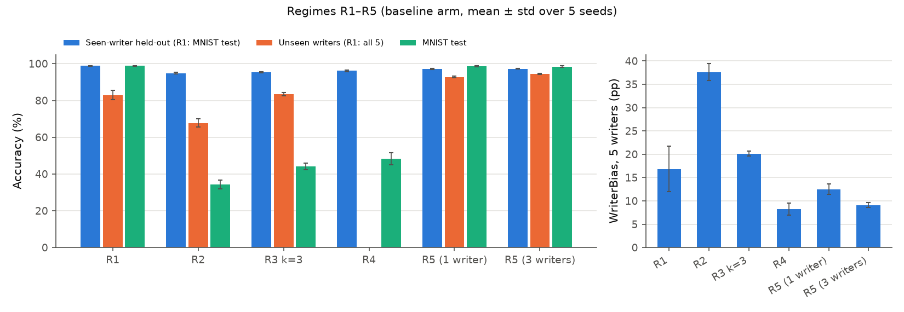
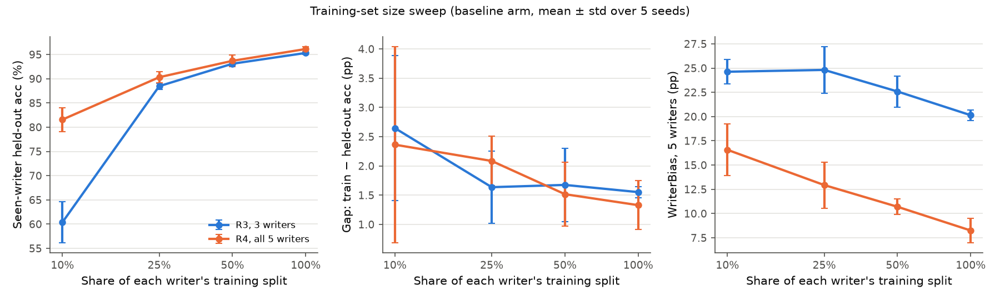
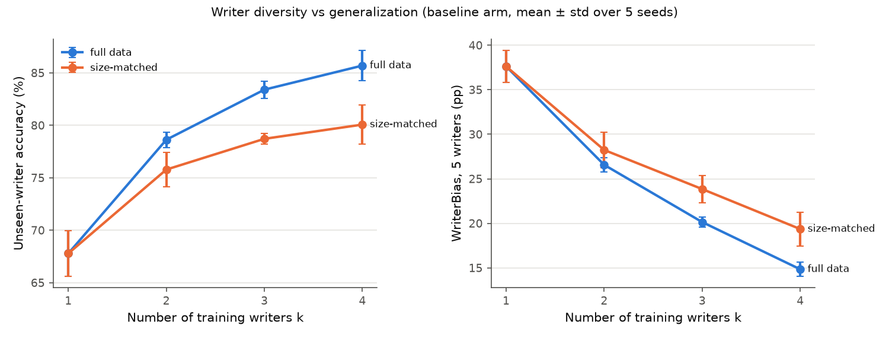
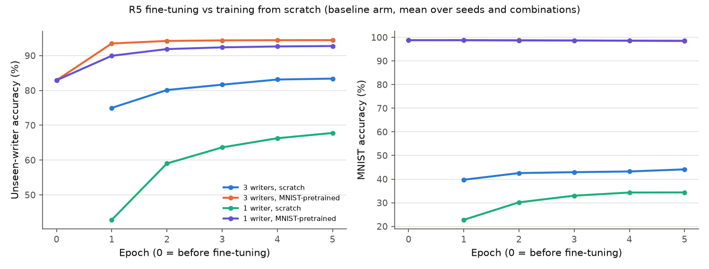

# Writer diversity and cross-writer generalization in a stylus digit CNN

Cao Chí Minh (project lead) and the CustomDataCNN team. This study repo extends [`ProfK602170/CustomDataCNN`](https://github.com/ProfK602170/CustomDataCNN).

## Abstract

We collected 10,000 stylus-written digits from 5 writers and trained the team's CNN under five data regimes (R1–R5), 5 seeds each, 1,205 training runs in all. The proposal's core hypothesis was that **more writer diversity improves cross-writer generalization and lowers WriterBias**. The results support it.

- Going from 1 to 4 training writers raises unseen-writer accuracy from 67.8 ± 2.2% to 85.7 ± 1.4%. WriterBias, the max−min accuracy spread over the 5 writers, falls from 37.6 to 14.8 pp.
- The effect holds when the total training size is fixed at one writer's worth of images: +12.3 ± 2.0 pp accuracy and −18.3 ± 2.2 pp WriterBias (both p < 0.001).
- The classic train-vs-test gap on the training writers barely moves (1.3–1.8 pp in every regime). The gap that writer structure controls is the **cross-writer gap**, seen-writer minus unseen-writer accuracy, which shrinks from 27.0 to 9.8 pp.
- Pre-training on MNIST and then fine-tuning on stylus data (R5) is the best regime: 94.4 ± 0.4% on unseen writers. It costs only 0.3 pp of MNIST accuracy, so there is no catastrophic forgetting at this learning rate.
- In the reverse direction, stylus-trained models reach only 47.4% on MNIST. One 3×3 dilation pass on the training images, the condition named in advance, raises this by **+12.6 ± 8.0 pp** (p = 0.02). MNIST-style size and centering normalization combined with dilation raises it by **+22.1 ± 5.2 pp** (p = 0.001).

## 1. Data and method

**Data.** Each writer wrote 200 of each digit 0–9 on a tablet with a stylus. The digits are stored as 28×28 MNIST-format images in `mydata/<writer>/`. The writers are Gia Huy, Le Khoi, Le Kiet, Minh Cao and Minh Ngo. The team's committed split gives each writer about 1,713 training and 286 held-out images (86/14). Every result below is measured on held-out images only. For the cross-domain tests, the standard MNIST training set (60,000) and test set (10,000) are used. The collection protocol is described in the team doc "Data collection process" on the project Drive.

**Model.** The model is the team's architecture from `masterConfig.json` on the project Drive: conv 5×5 (32) → pool → conv 3×3 (32) → pool → FC 128 → FC 32 → 10. It trains with Adam, lr 1e-3, batch 64, for 5 epochs. The architecture is fixed across all regimes and arms (`digitstudy/torch_model.py`).

**Regimes** (`digitstudy/regimes.py`, `configs/regimes.json`). These follow the team's "Project proposal document (DL)".

| Regime | Training data | Runs per seed |
|---|---|---|
| R1 | MNIST only (60k) | 1 |
| R2 | One writer | 5 (each writer) |
| R3 | k ∈ {2, 3, 4} writers, all of their data | every combination (10 + 10 + 5) |
| R3s | Same as R3, but capped at one writer's size (≈1,712 images) | every combination |
| R4 | All 5 writers | 1 |
| R3f / R4f | R3 (k = 3) and R4 with 10%, 25% or 50% of each writer's training split | every combination |
| R5 | R1's model, fine-tuned on 1 or 3 writers at lr × 0.1 | 5 + 10 |

**Preprocessing arms.** These apply to all stylus images and never to MNIST images:
- baseline
- `dilate_k3_i1`: one 3×3 grayscale dilation pass
- `norm_mnist`: crop to the bounding box, scale the longer side to 20 px, and centre by center of mass
- `norm_mnist_dilate_k3_i1`: normalization, then dilation

**Metrics** (definitions in `digitstudy/regime_report.py`)
- *Seen acc*: accuracy on the training writers' held-out splits. *Unseen acc*: accuracy on writers left out of training.
- *WriterBias*: max − min accuracy over the 5 writers' held-out splits, as defined in the proposal.
- *Gap acc*: train accuracy − seen held-out accuracy. *Gap loss*: seen held-out loss − train loss.
- *Cross-writer gap*: seen acc − unseen acc.
- *Forgetting*: R1's MNIST accuracy − R5's MNIST accuracy, for the same seed.
- Per-class precision, recall and F1 with macro averages.

**Statistics.** Each number is averaged over writer combinations within a seed, then reported as mean ± std over 5 seeds (0–4). Comparisons are paired by seed (two-sided paired t-test). Trends over k or data size use Spearman ρ on the 20 seed-level points. Section 2 of `configs/regimes.json` names the core-hypothesis test in advance: the size-matched series, Spearman ρ plus k = 1 vs k = 4. Other tests are exploratory and not corrected for multiple comparisons.

Full tables: [`results/regimes/REGIMES.md`](results/regimes/REGIMES.md). Raw runs: `results/regimes/runs.jsonl`. Reproduce with `python -m digitstudy regimes` (about 90 minutes on a 20-thread CPU).

## 2. Results by research question

### RQ (primary): how does the writer structure of the training data affect (1) the generalization gap and (2) WriterBias?

**Answer: mixed.** WriterBias: **supported**. Writer diversity lowers it sharply. Generalization gap: **supported for the cross-writer gap, not supported for the in-writer gap.** The usual train-vs-held-out gap stays at 1–2 pp whatever the writer structure. What changes is how far accuracy drops on writers the model never saw.

| Regime | Train images | Gap acc (pp) | Cross-writer gap (pp) | Unseen-writer acc | WriterBias (pp) |
|---|---|---|---|---|---|
| R1 (MNIST) | 60,000 | 0.5 ± 0.1 | — (all writers unseen) | 82.9 ± 2.5 | 16.9 ± 4.9 |
| R2 (1 writer) | 1,713 | 1.3 ± 0.5 | 27.0 ± 2.1 | 67.8 ± 2.2 | 37.6 ± 1.8 |
| R3 k=2 | 3,426 | 1.6 ± 0.1 | 16.1 ± 0.4 | 78.6 ± 0.7 | 26.6 ± 0.8 |
| R3 k=3 | 5,140 | 1.6 ± 0.1 | 11.9 ± 0.6 | 83.4 ± 0.8 | 20.1 ± 0.5 |
| R3 k=4 | 6,853 | 1.6 ± 0.4 | 9.8 ± 0.7 | 85.7 ± 1.4 | 14.8 ± 0.8 |
| R4 (5 writers) | 8,566 | 1.3 ± 0.4 | — (no unseen writer) | — | 8.3 ± 1.3 |
| R5 (1 writer, MNIST init) | 1,713 | 0.3 ± 0.4 | 4.3 ± 0.6 | 92.8 ± 0.5 | 12.5 ± 1.1 |
| R5 (3 writers, MNIST init) | 5,140 | 0.6 ± 0.2 | 2.8 ± 0.4 | 94.4 ± 0.4 | 9.1 ± 0.5 |

- From k = 1 to k = 4: cross-writer gap −17.3 ± 2.1 pp (ρ = −0.97, p < 1e-11) and WriterBias −22.8 ± 1.8 pp (ρ = −0.97). Gap acc changes by only +0.3 ± 0.6 pp (ρ = +0.27, p = 0.25).
- WriterBias is driven by the writers themselves. In R2, each writer's own model scores 90–99% on that writer. As an unseen writer, though, Gia Huy is read at 83.4% while Le Kiet is read at 59.1% (REGIMES.md §6).



### RQ1: Does single-writer training (R2) give a low in-writer gap but high WriterBias and poor accuracy on unseen writers?

**Answer: supported.**

- R2's in-writer gap is small: train 96.1 ± 0.4% against seen held-out 94.8 ± 0.4%, a gap of 1.3 ± 0.5 pp. That is no larger than the multi-writer regimes.
- R2 has the highest WriterBias of any regime, 37.6 ± 1.8 pp.
- R2 has the worst unseen-writer accuracy, 67.8 ± 2.2% (macro-F1 67.2). That is 15 pp below even the MNIST-only model R1.
- R2 transfers worst to MNIST: 34.4 ± 2.4%.
- Per class, the R2 model fails most on 3 (recall 35.0%), 8 (F1 57.9) and 5 (F1 60.7) for unseen writers.

A model trained on one writer fits that writer well and does not generalize past them. The in-writer gap gives no warning of this.

The figure for RQ1 is the overview figure above (R2 bars).

### RQ2: What happens when the training set gets smaller?

**Answer: mixed.** Shrinking the data lowers accuracy and raises WriterBias, as expected. The in-writer generalization gap, however, grows only slightly, and the change is not significant.

| Regime | Share of data | Train images | Seen held-out acc | Gap acc (pp) | Gap loss (nats) | WriterBias (pp) |
|---|---|---|---|---|---|---|
| R3 k=3 | 10% | 513 | 60.4 ± 4.2 | 2.6 ± 1.2 | 0.055 ± 0.021 | 24.6 ± 1.3 |
| R3 k=3 | 25% | 1,284 | 88.5 ± 0.6 | 1.6 ± 0.6 | 0.082 ± 0.020 | 24.8 ± 2.4 |
| R3 k=3 | 50% | 2,570 | 93.1 ± 0.5 | 1.7 ± 0.6 | 0.090 ± 0.020 | 22.6 ± 1.6 |
| R3 k=3 | 100% | 5,140 | 95.3 ± 0.3 | 1.6 ± 0.1 | 0.084 ± 0.005 | 20.1 ± 0.5 |
| R4 | 10% | 855 | 81.6 ± 2.5 | 2.4 ± 1.7 | 0.099 ± 0.019 | 16.6 ± 2.7 |
| R4 | 25% | 2,140 | 90.3 ± 1.2 | 2.1 ± 0.4 | 0.119 ± 0.018 | 12.9 ± 2.4 |
| R4 | 50% | 4,283 | 93.7 ± 1.2 | 1.5 ± 0.5 | 0.092 ± 0.025 | 10.7 ± 0.8 |
| R4 | 100% | 8,566 | 96.1 ± 0.5 | 1.3 ± 0.4 | 0.076 ± 0.011 | 8.3 ± 1.3 |

- **WriterBias** falls as data grows. R3: ρ = −0.77, and 100% vs 10% is −4.5 ± 1.1 pp (p < 0.001). R4: ρ = −0.88, and 100% vs 10% is −8.3 ± 3.4 pp (p = 0.006).
- **Gap acc** is about 1 pp larger at 10%, but not significantly. R3: −1.1 ± 1.2 pp, p = 0.10. R4: −1.0 ± 2.0 pp, p = 0.30.
- **Gap loss** has no consistent direction. It grows with size for R3 (ρ = +0.50) and shrinks for R4 (ρ = −0.49).
- **Underfitting caveat.** The 10% runs keep the fixed 5 epochs, so they take one tenth of the gradient steps. R3 at 10% reaches only about 63% train accuracy, so these models underfit rather than overfit. A small gap here does not mean they generalize well.
- **Size versus writers.** At equal size, 5 writers beat 3. R4 at 50% (4,283 images) has a WriterBias of 10.7 pp; R3 at 100% (5,140 images) has 20.1 pp. Within this range, how many writers are in the data matters more for WriterBias than how many images.



### RQ3: Does multi-writer training (R3/R4) beat single-writer training (R2)?

**Answer: supported. This is the pre-registered core-hypothesis test.** Diversity helps even when the extra writers bring no extra images.

| Series | k = 1 | k = 2 | k = 3 | k = 4 | k = 4 vs k = 1 |
|---|---|---|---|---|---|
| Unseen acc, full data | 67.8 ± 2.2 | 78.6 ± 0.7 | 83.4 ± 0.8 | 85.7 ± 1.4 | +17.9 ± 2.2 pp, p < 0.001 |
| Unseen acc, size-matched (≈1,712 images) | 67.8 ± 2.2 | 75.8 ± 1.6 | 78.7 ± 0.5 | 80.1 ± 1.9 | **+12.3 ± 2.0 pp, p < 0.001** |
| WriterBias, full data | 37.6 ± 1.8 | 26.6 ± 0.8 | 20.1 ± 0.5 | 14.8 ± 0.8 | −22.8 ± 1.8 pp, p < 0.001 |
| WriterBias, size-matched | 37.6 ± 1.8 | 28.2 ± 2.0 | 23.8 ± 1.5 | 19.4 ± 1.9 | **−18.3 ± 2.2 pp, p < 0.001** |

- Size-matched Spearman ρ: +0.92 for unseen accuracy and −0.96 for WriterBias (both p < 1e-7). Under the full-data series, R4 with all 5 writers reaches a WriterBias of 8.3 ± 1.3 pp.
- About two thirds of the full-data accuracy gain remains when size is held fixed (12.3 of 17.9 pp). Diversity, not just volume, drives the effect.
- The size-matched models have a slightly larger in-writer gap at k = 4 than at k = 1 (+0.6 ± 0.4 pp, p = 0.03). This fits the primary RQ: diversity does not reduce the in-writer gap.



### RQ4: How do writer-trained models compare with MNIST-trained ones (R1), and does fine-tuning (R5) cause catastrophic forgetting?

**Answer: mixed for R1 vs writer-trained models. Not supported for catastrophic forgetting. Supported for R5 being best.**

- **R1 vs writer-trained models.** On stylus writers, R1 (MNIST only, 60k images) gets 82.9 ± 2.5%. That beats single-writer training (R2, 67.8%) and roughly matches 3 writers (R3 k = 3, 83.4%). It falls short of 4 writers (85.7%). R1 is uneven across writers: Minh Cao 74.4% against Le Khoi 91.1%, a WriterBias of 16.9 ± 4.9 pp. Its errors concentrate on 1 (recall 56.4%), 9 (61.0%) and 6 (68.1%).
- **Stylus-trained models on MNIST.** These transfer badly: 34.4% (R2), 44.1% (R3 k = 3) and 48.3% (R4). The R4 model labels 8 for most inputs (precision 28.8%, recall 93.2%) and almost never gets 7 right (recall 0.6%).
- **R5 fine-tuning is best on every stylus metric.**
  - 1 writer: 92.8 ± 0.5% unseen, +25.0 ± 1.9 pp over R2, p < 1e-5.
  - 3 writers: 94.4 ± 0.4% unseen, +11.0 ± 0.8 pp over R3 k = 3, p < 1e-5.
  - It also has the lowest cross-writer gap (2.8 pp) and a WriterBias of 9.1 pp.
  - One fine-tuning epoch already gives 90.0% (1 writer) and 93.5% (3 writers).
- **No catastrophic forgetting.** After fine-tuning, MNIST accuracy is 98.5 ± 0.3%, against R1's 98.8 ± 0.2%: a loss of 0.3 ± 0.2 pp for both the 1-writer and 3-writer runs. The likely reason is the low learning rate (lr × 0.1) and the short schedule of 5 epochs. A higher learning rate or longer schedule might forget more; this was not tested.



## 3. Stylus → MNIST: does dilation fix the domain gap?

This is the team's original Regime 4 question. Train on all 10,000 stylus digits, test on the 10,000 MNIST test images, and preprocess the training images only (`custom_to_mnist` in `configs/study.json`). The headline condition, one 3×3 dilation pass, was named before the runs (`preregistration`).

| Condition (PyTorch, 5 seeds) | MNIST accuracy | Δ vs baseline |
|---|---|---|
| Baseline | 47.35 ± 7.98 | — |
| **3×3 dilation, 1 pass (pre-registered)** | 59.94 ± 3.02 | **+12.59 ± 8.00 pp (+29.6% relative, 5/5 seeds, p = 0.024)** |
| Centering by center of mass only | 64.76 ± 3.18 | +17.42 ± 5.93 pp (p = 0.003) |
| MNIST normalization (size + centre) | 67.22 ± 2.96 | +19.87 ± 5.65 pp (p = 0.001) |
| Normalization + 3×3 dilation | 69.46 ± 3.19 | +22.11 ± 5.24 pp (+49.5% relative, p = 0.001) |
| Heavy dilation (3×3 twice = 5×5) | 41.49 ± 5.68 | −5.86 ± 7.20 pp |

- **NumPy CNN.** The from-scratch NumPy CNN agrees: 50.85 → 57.37% with dilation (+6.52 pp, p = 0.04) and 63.46% with normalization plus dilation (+12.61 pp, p = 0.001).
- **Regime study agrees.** The regime study repeats the result on the team's 8,566-image training split (REGIMES.md §3). For R4, dilation adds +11.2 pp and normalization plus dilation adds +22.3 pp. The same arms also help R3 k = 3 (+10.7 and +19.6 pp).
- **Class 8 over-prediction is fixed by dilation.** The share of MNIST images predicted as 8 drops from 35.2% to 5.3%. Precision for 8 rises from 30% to 88%.
- **Class 7 failure is fixed only partly by dilation.** Recall for 7 rises from 0.9% to 22.2%. It reaches 72–76% only with normalization.
- **Remaining error.** Most 9s are still read as 4s.
- **Not a within-stylus fix.** Within stylus data, dilation adds at most about 1 pp for unseen writers (R3 k = 3: +0.9, p = 0.03; R3 k = 4: +1.0, p = 0.03). It slightly hurts R5 (−0.9 to −1.3 pp). Dilation is a domain-matching fix for the stroke-width gap with MNIST, not a general writer-generalization fix.

Figures: `results/figures/deltas_custom_to_mnist.png` and `results/figures/confusion_custom_to_mnist_torch.png`. Full tables: [`results/RESULTS.md`](results/RESULTS.md).

## 4. Comparison with the team's earlier results

The team's first Regime 4 evaluation used the notebook pipeline, the same `masterConfig.json` and 3 runs. Its sources on the project Drive are "Evaluation of regime 4 test 1" and `regime4_summary_20260517_185311.csv`, and its numbers are copied in [`results/team_reference/`](results/team_reference/README.md).

| Measure | Team, 3 runs | This study, R4 baseline, 5 seeds |
|---|---|---|
| Train accuracy | 96.8–97.2% | 97.5 ± 0.4% |
| Held-out accuracy per writer | Minh Cao 91.6–93.0, Minh Ngo 94.4, Le Kiet 95.1–96.9, Le Khoi 99.3–100, Gia Huy 99.65–100 | Minh Cao 91.6 ± 1.0, Minh Ngo 95.0 ± 0.8, Le Kiet 94.8 ± 1.1, Le Khoi 99.3 ± 0.5, Gia Huy 99.9 ± 0.3 |
| MNIST test accuracy | 42.8 / 51.4 / 57.2 (mean 50.5) | 48.3 ± 3.3 |
| Class 8 precision / class 7 recall on MNIST | 27.2% / 0.45% | 28.8% / 0.6% |

This study reproduces the team's numbers within run-to-run noise. The team's write-up blamed thin strokes and proposed dilation; Section 3 confirms that dilation helps. The write-up also listed centering as already checked. In fact, centre-of-mass centering alone adds +17.4 pp, more than dilation does. The committed stylus images are not MNIST-centred: their centre of mass varies by about 1.2 px across samples, against 0.3 px for MNIST.

## 5. Discussion

The writer structure of the training data matters more than its size within the range we could test. Four writers at one writer's data volume beat one writer by 12 pp on unseen writers, and five writers at half the data have half the WriterBias of three writers at full data. The in-writer train/test gap is a misleading health check for this task: it was 1–2 pp in every regime, including R2, whose accuracy on new writers was 68%. A held-out-writer evaluation is needed to see the problem.

The strongest single intervention is MNIST pre-training followed by fine-tuning at a low learning rate. It combines MNIST's volume and diversity (thousands of writers) with the stylus domain, and it loses almost nothing on MNIST. Preprocessing is direction-specific. Dilation and normalization close much of the stylus → MNIST gap, mostly by fixing stroke width and centring. They do little or nothing for stylus → stylus generalization.

## 6. Limitations

- **Only 5 writers.** Per-writer effects are large (unseen accuracy for single-writer models ranges from 59% to 83%), and each mixed regime has at most 10 combinations. The trend over k uses 4 points per seed. Claims about "writers in general" need many more writers.
- **One location, one population.** All writers are university students on the same team, writing in the same setting. Age, handwriting education and script background are not varied.
- **Tablet stroke artifacts.** The digits were written with a stylus on a tablet. Low pen friction causes overshoot and stray strokes, and pen hover or lift can leave ghost lines. Strokes are about 1 px wide with uniform intensity, unlike scanned pen-on-paper MNIST digits. Some of the writer effects may come from these device artifacts rather than handwriting style.
- **MNIST/stylus preprocessing gap.** MNIST digits are size-normalized to a 20 px box and centred by centre of mass; the committed stylus images are not. All cross-domain numbers depend on this, as Section 3 shows (+17 pp from centering alone).
- **Split ratio.** The team's committed per-writer split is about 86/14 (1,713 / 286), not the proposal's 80/20. Held-out sets of 286 images per writer give a binomial standard error of about 1–2 pp per writer.
- **Architecture and schedule.** We used the team's `masterConfig.json` (conv 32→32, 5×5 then 3×3), not the 32→64 3×3 network in the proposal draft. Training is fixed at 5 epochs with no per-regime tuning. That makes the smallest size-sweep runs underfit (Section RQ2).
- **Multiple comparisons.** Only the size-matched diversity test and the 3×3 dilation stylus → MNIST test were named in advance. Other p-values are uncorrected and exploratory.
- **Forgetting was tested in one setting** (lr × 0.1, 5 epochs).

## 7. Reproduce

```bash
pip install torch --index-url https://download.pytorch.org/whl/cpu
pip install -r requirements.txt
python -m digitstudy reproduce      # dilation study + regimes, then RESULTS.md, REGIMES.md and figures
python -m digitstudy regimes-report # rebuild only the regime tables and figures from runs.jsonl
```

## References

- Team project and data: `ProfK602170/CustomDataCNN`. Drive docs: "Project proposal document (DL)", "Data collection process", "Evaluation of regime 4 test 1", `masterConfig.json`, `regime4_summary_20260517_185311.csv`.
- MNIST: Y. LeCun, C. Cortes, C.J.C. Burges, *The MNIST database of handwritten digits*.
